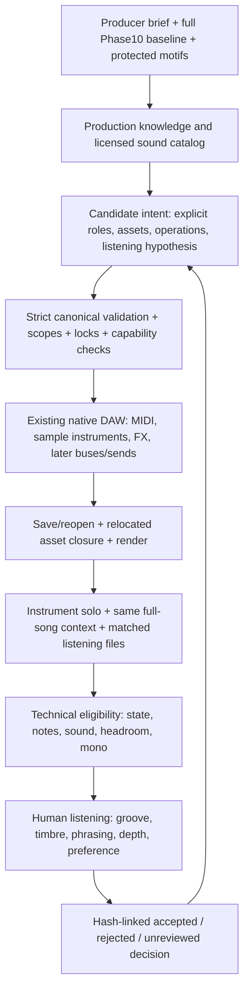

# Editable AI production: architecture and first consequential slice

Research/design baseline: **245a282b7e493611de37693d123c1e82b56d7ffc**, 2026-10-24. Read the project-local house-production audit and Phase 12 evidence first. The user prefers the **full Phase 10 song** musically and reports that the subsequent instrument and eight-bar experiments did not establish a worthwhile quality gain. That feedback overrides any inference from our audio metrics. Suno-class production is a long-term listening goal, not an achieved capability or a meter threshold.

The product remains a local producer working on **editable MIDI, instruments, sample maps, inserts, routing and automation in an existing DAW**. Audio is a derived audition. An opaque waveform generator cannot substitute for this state.

## What professional practice changes in the design

[Ableton's Groove Pool](https://www.ableton.com/en/live-manual/12/using-grooves/) separates timing, quantization, velocity and randomization. The producer must select a groove relationship per role and articulate notes with the actual chosen instrument, rather than perturb every part uniformly. [Attack's Deep Tech House](https://www.attackmagazine.com/technique/beat-dissected/deep-tech-house/) illustrates source selection, offbeat hats and velocity-shaped supporting percussion. These are production principles, not permission to redistribute its downloadable samples.

[Brikha's account of Groove La Chord](https://www.ableton.com/en/blog/aril-brikha-remaking-groove-la-chord-with-live-and-note/) puts a small set of sounds, chord-envelope behavior, performed filter/EQ and shared effect returns at the center of the record. Its educational project/sample downloads are **not reused**. An instrument substitution can change perceived phrasing even when MIDI is identical; the Phase 11 listening result demonstrated that problem here.

Consequently the priorities are: **curate sounds in the full musical context → establish kick/bass and accent hierarchy → shape articulations and musical conversation → shared signal paths/depth → polish**. More plugins, more notes, a target spectral curve or a louder master are not acceptance criteria. Source choice must precede attempts to repair an unsuitable sound with inserts.

## Feasibility and licensing matrix

“Verified” below means actual local host/PCM evidence, not a product's format list. Candidate software remains separately installed. No plugin binary, factory content or third-party sample pack is bundled with MIT Kuang.

| Priority / component | Actual evidence and constraints | License / primary sources | Decision |
| --- | --- | --- | --- |
| 1. SoundCraft native sampler | Phase 9 gate and a fresh `.local/producer/sampler-gate` run load a self-authored WAV, play MIDI, save/reopen, copy `Audio Files`, hide all original paths and repeat identical non-silent PCM. Ordinary adapter currently rejects sampler assets. Catalog exposes a **single sample source**, key/velocity bounds, tracking, ADSR, start, gate/one-shot and loop choices. Multi-zone SFZ, round robin and choke groups are not established. | Existing externally installed [SoundCraft 0.11.0](https://github.com/storytold/soundcraft/releases/tag/v0.11.0), **MIT OR Apache-2.0**, including its [MIT notice](https://raw.githubusercontent.com/storytold/soundcraft/v0.11.0/LICENSE-MIT) and installed release notices reviewed previously. No engine code copied or linked. Sample licenses are independent. | **Implement a content-addressed, licensed asset + canonical instrument binding and portable native bundle now.** This opens real sound-library choices. |
| 2. SoundCraft sends/aux | Phase 12's CLI-created post-fader send → bus → aux reverb has exact full native/PCM reopen and an exact muted-send/dry control. Schema 0.1 already models sends/buses. General adapter still rejects them. | Same external host; [existing bounded prototype](../tools/phase12_routing.py). | Next mapping slice: graph compilation, bus identity/asset closure, scoped routing edits and send automation. Do not pretend the sampler slice solves routing or sidechain. |
| 3. Vitalium | DISTRHO 1.0.6 VST3 works in SoundCraft with original patch component state and 771 static controls. Local Phase 11 integration is real; its original patches were not a listening win. Current patch helper is intentionally narrow. | GPL-3.0-or-later external component; [DISTRHO release announcement](https://kx.studio/News/?action=view&url=distrho-ports-2021-03-15-and-pawpaw-v11-releases), [port source](https://github.com/DISTRHO/DISTRHO-Ports/tree/2021-03-15/ports/vitalium). Official Vital source/application/content terms differ; [Vital](https://vital.audio/) is not automatically a freely redistributable binary/preset source. | Keep working optional backend; invest in human-selected/original patch auditions and articulation, not another bulk palette replacement. No current-official-Vital compatibility claim. |
| 4. sfizz / SFZ | Official UI repository lists VST3, LV2, AU and PD; **CLAP is not established**. Both official repositories are archived as of June 21, 2026. No sfizz instance has passed this project's discover/state/MIDI/relocation gates. SFZ is useful for velocity layers, key regions and future drum choke/round-robin maps; each opcode still needs backend support tests. | [sfizz library](https://github.com/sfztools/sfizz), [sfizz-ui](https://github.com/sfztools/sfizz-ui), both [BSD-2-Clause](https://raw.githubusercontent.com/sfztools/sfizz-ui/develop/LICENSE); [downloads](https://sfz.tools/sfizz/downloads/). Dependencies/content have separate terms. | Candidate after native one-shot assets, when a selected library actually needs richer mapping. Check maintenance/forks, exact binary availability and supported opcodes before installing. Not required now. |
| 5. Surge XT | Phase 11 reproduced silence in SoundCraft CLAP/VST3; the same 1.3.4 VST3 produced non-silent output in the separate Pedalboard host. This is a **host compatibility boundary**, not proof that the synth is bad or missing content. | GPL-3.0 external synth; [official source](https://github.com/surge-synthesizer/surge), [FAQ](https://surge-synthesizer.github.io/faq/). The FAQ permits distributing rendered sounds/songs, including factory-derived sounds; that is **not** blanket permission to redistribute factory patch/wavetable files. | Do not repeat discovery-only experiments. Reconsider only with an evidence-driven host fix or a validated editable alternate-host project. Frozen stems must be labelled as such, with MIDI/patch origins retained. |
| 6. CHOW Tape Model | Official project documents a physical tape-model plugin. Local discovery, parameter identity, state restoration, CPU behavior and real processed PCM are **not tested**. Color cannot rescue poor source choice or arrangement. | [AnalogTapeModel / CHOW Tape](https://github.com/jatinchowdhury18/AnalogTapeModel), [GPLv3 license](https://raw.githubusercontent.com/jatinchowdhury18/AnalogTapeModel/master/LICENSE). | Optional later color stage, requiring pinned binary, original bypass/on controls and matched context audition. No mandatory download or claimed compatibility. |
| 7. Carla / Ildaeil | Carla is a separate plugin host. Ildaeil wraps Carla inside a plugin; its README explicitly says hosted plugin parameters are **not exposed to the outer host**. Neither has passed Kuang's lifecycle gates. A nested GUI is not a provider-neutral automation API. | [Carla](https://github.com/falkTX/Carla), GPL-2.0-or-later; [Ildaeil](https://github.com/DISTRHO/Ildaeil), GPL-2.0 repository license. | A bounded fallback only if an essential selected instrument cannot run in SoundCraft. Require editable native alternate-host project, state, MIDI, deterministic render or documented nondeterminism. Do not install a new DAW stack speculatively. |

This milestone does not fetch new plugins or large dependency trees. The sampler and existing positive gates make that unnecessary. Unprobed rows remain unprobed, rather than being promoted to a “supported stack.”

## Sound-library boundary

The first library format is deliberately host-neutral: a strict manifest identifies one PCM file by SHA-256, its actual format/length, creator/source, SPDX license, license URL and notice, plus explicit semantic MIDI key/velocity bounds and root note. The instrument's canonical `preset_ref` pins that manifest. Paths are relative, confined and verified; changing a byte requires a new asset identity. Absolute source paths are provenance only outside portable state.

Possible content sources include [VCSL](https://github.com/sgossner/VCSL), whose publisher identifies it as **CC0**. Its largely acoustic collection is not automatically the right electronic drum palette; inspect individual candidates and their provenance before selecting them. [Wavparty's ER-1 page](https://wavparty.com/downloads/er-1-sample-pack/) offers electronic one-shots but does not establish raw redistribution rights on that page; no pack is fetched or bundled. Likewise “free” or “royalty-free” does not imply permission to redistribute raw files. [CC0's actual terms](https://creativecommons.org/publicdomain/zero/1.0/) differ from restrictive free-download licenses.

Initial importer accepts explicitly declared **CC0-1.0, CC-BY-4.0 or MIT** assets with the required attribution/notice and source record, and portable WAV PCM. This records the supplied license claim; it cannot authenticate ownership or grant rights a submitter lacks. Unlicensed/unknown content fails closed. No factory presets/samples are included. A small original synthesized drum fixture establishes the lifecycle; it is **not a claimed studio-quality library**. Sound selection remains a listening task.

One-shot-per-track is a consequential first step, not a full drum sampler. A future SFZ/multi-zone asset must preserve its entire dependency closure, region keys, velocity layers, choke rules, tuning, round robins and licenses; silent dropping of unsupported regions/opcodes is prohibited. Split tracks or a new canonical mapping must be explicit, with note provenance. Do not mislabel MIDI notes, semitones or cents as Hz/normalized controls to fit schema 0.1.

## Producer state and execution boundary

The AI proposes **musical and engineering intentions** against a known catalog and validated operation vocabulary. It does not emit host JSON, execute prose, choose arbitrary plugins or authorize its own quality gate. Inference providers remain optional and separate; no recursive Codex or paid model service is introduced. Existing SongSpec and typed transaction engine remain the symbolic boundary. New patch/source bindings are explicit versioned sidecars plus schema-0.1 instrument references; this is not a schema migration or silent reconciliation of manual host edits.

The renderer verifies all note fields/IDs, source SongSpec, insert order, mixer and automation. Native note IDs still need the existing manifest because SoundCraft merges imported clips. Device changes must not clear unrelated lanes. A sampled instrument remains **live MIDI + native sampler**, with editable sample mapping and controls; it is not a frozen full-track WAV. Unsupported external synth/sampler combinations and general routing fail explicitly until composed adapters are verified.

## Explicit optimization loop and quality gate

1. **Keep an incumbent.** Freeze full Phase 10 canonical/native/audio inventories. Record the intended improvement in words (for example, a kick with a clearer attack and appropriate body under this bass), the allowed roles, protected notes and the source/patch provenance.
2. **Prepare a small sound shortlist.** Validate license and files first. Audition actual samples/patches, pitches, velocity response, note length and release. A beautiful sustained preset can be unsuitable for a short stab. Do not rank by oscillator count or synth brand.
3. **Render independent and contextual views.** Instrument solos explain behavior; the unchanged full 64-bar context decides musical suitability. Preserve every source note unless a separately reviewed groove/arrangement intent authorizes changes. Match integrated loudness for audition and disclose every native calibration and offline constant gain.
4. **Reject technical failures.** Missing assets, silent voices, clipped output, invalid mappings, source drift, changed protected notes, broken state or relocation are ineligible. Band powers, transient windows, stereo and loudness are diagnostics, not an optimization reward to maximize.
5. **Require a human decision.** A review record binds reviewer, actual audition-file hashes, preference, reasons and candidate/parent fingerprints. Default is `unreviewed`; numeric results never imply `preferred`. Reject stale/wrong audition identities and preserve the incumbent on rejection. An explicit recorded reviewer declaration is evidence of feedback, not proof the software can verify a person listened.
6. **Integrate only a preferred change.** Re-evaluate in the full arrangement and on another playback system. Keep bad outcomes as findings. Structural composition, source timbre, bus mix and mastering need separate hypotheses so the cause of a listening change remains understandable.

The Suno reference is different music with vocals and a different duration. It can guide discussion of perceived density, articulation and spatial depth, or private numeric comparisons. Its recording, vocals, motifs and proprietary stems are neither copied nor redistributed. Matching its LUFS or side-energy percentage is not matching its production quality.

## This implementation slice and acceptance

**Chosen:** a new opt-in sample-asset adapter and a producer audition/review ledger. Legacy creation, canonical schema 0.1, existing adapters and all 297 prior tests stay intact. The implementation must support externally prepared human-selected licensed WAVs, not only names of hardcoded replacement kicks.

Acceptance requires:

- Strict hash-addressed asset manifests; confined relative files; bounded PCM, provenance and license validation; missing/changed/extra files and symlinks rejected.
- Explicit mapping of root/key/velocity integers in the asset manifest, with supported continuous/discrete sampler controls in a correctly typed registry. No ignored out-of-range notes or invented SFZ/multi-zone behavior.
- A live native sampler compiled only through actual `mix.sampler_load`; complete source/asset identity manifest, all MIDI and original SongSpec preserved, all unaffected native state exact.
- Save/reopen, relocated bundle with original library/bundle paths hidden, non-silent 48k/24bit full-song render and identical repeated PCM; valid parameter edits and exact inverse receipts; failure leaves source and published outputs untouched.
- Instrument audition and **full 64-bar** listen-in-context regression. Generated test tones prove the mechanism, not a production-quality milestone. Ship an A/B listening ZIP only when there is a credible curated sound experiment worth judging; otherwise publish the architecture, editable infrastructure proof, and an explicitly unreviewed listening ledger without pretending an improved song was produced.
- All 297 regressions plus new meaningful tests, Python 3.11/3.13 CI and wheel/install smoke. All scratch in `.local/producer`, new results in `artifacts/producer`; previous artifacts remain byte-identical. Actual final evidence and remaining gaps belong in `docs/STATUS.md` and a machine-readable verification report.

Still proposed after this slice: general buses/sends with transactional route edits, SFZ/multi-layer drums, a broader license-reviewed human sound catalog, patch performance macros, true input-triggered sidechain, and a musical planner capable of evaluating more than templates. This design is not an assertion that Kuang already produces Suno-class or professional music.

## Phase14 implementation update: mixed live sources and one-level shared paths

[Phase14](PHASE14.md) composes the positive sampler and Vitalium lifecycles in
`production_host.ProductionAdapter`, leaving the older adapters/defaults strict.
It maps canonical MIDI→bus post-fader sends to actual CLI-created Bus/Aux objects,
including a real six-source drum sum, separate100%-wet returns, linear send-trim
lanes and existing FX/mixer lanes. Cycle validation, native slot/address/unit
bounds, full original-strip projection, aux-state validation, relative asset/
preset closure, exact state/PCM reopen and scoped static edits are mandatory.
Pre-fader/custom-pan sends, nested buses, arbitrary structural transactions,
external instrument automation and true input sidechain remain rejected.

A channel-owned dB trim explicitly offsets the canonical Send.gain_db. Static
normalized stereo spread maps two native channel pan positions with verified
bounds; it is not a hidden phase-widening processor. The first apparent bus
proof was rejected when strict output validation found dry sources still on
Main: a scalar plural selector was ignored. Audio matching alone did not prove
routing. The corrected singular selector and causal summed-compressor/return
controls establish the working one-level slice.

The full Phase13→Phase14 A/B now uses four coordinated original role patches,
short articulated foreground voices, restored chord fundamentals, a restrained
pad, phrase tone/echo performances and documented voicing/answer changes. It
preserves the preferred song and original drum/bass/call MIDI. Source-role
calibration precedes whole-song LUFS matching. The six independent native groups
reconstruct the record within3LSB; internal controls remain evidence rather than
user listening homework. The explicit human preference gate is still pending.
Neither these working paths nor the external synth brand imply Suno-class or
professional production quality. Licensing stays separate: original MIT patches/
code, inherited declared CC0 samples, optional separately installed GPL Vitalium,
no bundled binary/factory/Suno content.
